<!-- Generated by Suite Builder. EDIT RULES: do not edit this file; regenerating replaces all of it. Your own notes on the site go in ai/AI-README.md. Creator: https://github.com/ghost-in-the-kernel -->
# The site's shape

https://www.perfectserve.com as the crawl saw it: each box a kind of page (its class and address), each arrow a link
between them. A solid arrow is followed by a navigation test; a dotted one is not, and why is below.
Navigation tests follow 92 of 113 transitions (coverage: transitions);
every kind of page is opened by its smoke test, 30 of 30.

```mermaid
flowchart LR
  n0["HomePage<br/>/"]
  n1["AudiencePage<br/>/who-we-serve/specialty/*"]
  n2["ResourcePage<br/>/resources/*"]
  n3["ResourcesPage<br/>/resources/*/*"]
  n4["ArticlePage<br/>/resources/case-study/*"]
  n5["SolutionsClinicalCommunicationPage<br/>/solutions/clinical-communication-collaboration"]
  n6["WhoWeServeTeamPage<br/>/who-we-serve/team/physicians"]
  n7["WorkEmailPage<br/>/company/*"]
  n8["BlogPostPage<br/>/resources/*/*"]
  n9["SolutionsPhysicianSchedulingSoftwarePage<br/>/solutions/physician-scheduling-software"]
  n10["ResourcesDownloadPage<br/>/resources/download/*"]
  n11["WhyPerfectservePage<br/>/why-perfectserve"]
  n12["WhyPerfectserveTrustSecurityPage<br/>/why-perfectserve/trust-security"]
  n13["ResourcesVideoPage<br/>/resources/video/*"]
  n14["WhoWeServeTeam2Page<br/>/who-we-serve/team/nurses"]
  n15["SolutionsIntelligentAnsweringPage<br/>/solutions/intelligent-answering"]
  n16["ResourcesProductToursPage<br/>/resources/product-tours/*"]
  n17["CompanyLegalPage<br/>/company/legal/*"]
  n18["SolutionsHealthcareOperatorConsolePage<br/>/solutions/healthcare-operator-console"]
  n19["FirstNamePage<br/>/*"]
  n20["WhoWeServeTeam3Page<br/>/who-we-serve/team/practice-managers"]
  n21["SolutionsMedicalAnsweringServicePage<br/>/solutions/medical-answering-service"]
  n22["CompanyPage<br/>/company/*/*"]
  n23["WhyPerfectserveSupportModelPage<br/>/why-perfectserve/support-model"]
  n24["WhoWeServeHospitalsPage<br/>/who-we-serve/hospitals-and-health-systems"]
  n25["WhyPerfectserveCalculatorsPage<br/>/why-perfectserve/calculators/*"]
  n26["ResourcesListPage<br/>/resources"]
  n27["WhyPerfectserveBestInPage<br/>/why-perfectserve/best-in-klas"]
  n28["WhoWeServeMedicalPage<br/>/who-we-serve/medical-practices"]
  n29["GoPage<br/>/go/*"]
  n30(["/solutions/integrations<br/>not read"])
  n31(["/who-we-serve/specialty/radiology<br/>not read"])
  n32(["/who-we-serve/specialty/ob-gyn<br/>not read"])
  n33(["/who-we-serve/specialty/gastroenterology<br/>not read"])
  n34(["/who-we-serve/specialty/primary-care<br/>not read"])
  n35(["/who-we-serve/specialty/anesthesiology<br/>not read"])
  n36(["/who-we-serve/specialty/surgical<br/>not read"])
  n37(["/who-we-serve/team/finance<br/>not read"])
  n38(["/who-we-serve/team/it<br/>not read"])
  n39(["/who-we-serve/team/schedulers<br/>not read"])
  n40(["/who-we-serve/team/hospital-operations<br/>not read"])
  n41(["/why-perfectserve/gartner-magic-quadrant<br/>not read"])
  n42(["/resources/videos<br/>not read"])
  n43(["/resources/events<br/>not read"])
  n44(["/resources/case-studies<br/>not read"])
  n45(["/resources/comparisons<br/>not read"])
  n46(["/resources/faq<br/>not read"])
  n47(["/resources/product-tours<br/>not read"])
  n48(["/company/nurses-of-note<br/>not read"])
  n49(["/solutions/connect-messaging<br/>not read"])
  n50(["/solutions/feature-comparison<br/>not read"])
  n0 --> n3
  n0 --> n4
  n1 --> n4
  n2 --> n10
  n2 --> n8
  n2 --> n3
  n3 -.-> n13
  n3 --> n10
  n3 -.-> n4
  n3 -.-> n8
  n4 -.-> n13
  n4 --> n8
  n4 -.-> n10
  n4 --> n4
  n5 --> n4
  n5 --> n16
  n7 --> n22
  n7 --> n8
  n7 -.-> n13
  n7 -.-> n4
  n7 -.-> n10
  n7 --> n19
  n7 --> n29
  n8 -.-> n13
  n8 --> n4
  n8 --> n8
  n8 --> n10
  n8 --> n3
  n8 --> n7
  n8 --> n22
  n9 --> n4
  n9 -.-> n8
  n9 --> n16
  n10 -.-> n13
  n10 --> n4
  n10 -.-> n8
  n10 -.-> n10
  n11 --> n4
  n12 --> n4
  n12 --> n19
  n13 --> n4
  n13 -.-> n8
  n13 -.-> n10
  n13 -.-> n13
  n21 --> n4
  n21 --> n16
  n21 -.-> n19
  n21 --> n25
  n22 -.-> n13
  n22 -.-> n4
  n22 -.-> n8
  n22 -.-> n10
  n23 --> n4
  n23 --> n19
  n25 --> n19
  n25 --> n25
  n26 --> n8
  n27 --> n4
  menu{{"Header and footer: on every page"}}
  menu --> n3
  menu --> n5
  menu --> n9
  menu --> n15
  menu --> n18
  menu --> n21
  menu --> n30
  menu --> n24
  menu --> n28
  menu --> n1
  menu --> n1
  menu --> n31
  menu --> n32
  menu --> n33
  menu --> n34
  menu --> n35
  menu --> n36
  menu --> n6
  menu --> n14
  menu --> n20
  menu --> n37
  menu --> n38
  menu --> n39
  menu --> n40
  menu --> n11
  menu --> n12
  menu --> n23
  menu --> n27
  menu --> n41
  menu --> n2
  menu --> n2
  menu --> n42
  menu --> n43
  menu --> n44
  menu --> n25
  menu --> n45
  menu --> n46
  menu --> n47
  menu --> n2
  menu --> n7
  menu --> n7
  menu --> n7
  menu --> n48
  menu --> n7
  menu --> n3
  menu --> n19
  menu --> n49
  menu --> n50
  menu --> n1
  menu --> n26
  menu --> n29
  menu --> n17
  menu --> n17
  menu --> n17
  menu --> n0
```

## Not followed

- ResourcesPage to ResourcesVideoPage: hidden when the page loads (a closed menu, a carousel's other slide)
- ResourcesPage to ArticlePage: hidden when the page loads (a closed menu, a carousel's other slide)
- ResourcesPage to BlogPostPage: hidden when the page loads (a closed menu, a carousel's other slide)
- ArticlePage to ResourcesVideoPage: hidden when the page loads (a closed menu, a carousel's other slide)
- ArticlePage to ResourcesDownloadPage: hidden when the page loads (a closed menu, a carousel's other slide)
- WorkEmailPage to ResourcesVideoPage: hidden when the page loads (a closed menu, a carousel's other slide)
- WorkEmailPage to ArticlePage: hidden when the page loads (a closed menu, a carousel's other slide)
- WorkEmailPage to ResourcesDownloadPage: hidden when the page loads (a closed menu, a carousel's other slide)
- BlogPostPage to ResourcesVideoPage: hidden when the page loads (a closed menu, a carousel's other slide)
- SolutionsPhysicianSchedulingSoftwarePage to BlogPostPage: hidden when the page loads (a closed menu, a carousel's other slide)
- ResourcesDownloadPage to ResourcesVideoPage: hidden when the page loads (a closed menu, a carousel's other slide)
- ResourcesDownloadPage to BlogPostPage: hidden when the page loads (a closed menu, a carousel's other slide)
- ResourcesDownloadPage to ResourcesDownloadPage: hidden when the page loads (a closed menu, a carousel's other slide)
- ResourcesVideoPage to BlogPostPage: hidden when the page loads (a closed menu, a carousel's other slide)
- ResourcesVideoPage to ResourcesDownloadPage: hidden when the page loads (a closed menu, a carousel's other slide)
- ResourcesVideoPage to ResourcesVideoPage: hidden when the page loads (a closed menu, a carousel's other slide)
- SolutionsMedicalAnsweringServicePage to FirstNamePage: hidden when the page loads (a closed menu, a carousel's other slide)
- CompanyPage to ResourcesVideoPage: hidden when the page loads (a closed menu, a carousel's other slide)
- CompanyPage to ArticlePage: hidden when the page loads (a closed menu, a carousel's other slide)
- CompanyPage to BlogPostPage: hidden when the page loads (a closed menu, a carousel's other slide)
- CompanyPage to ResourcesDownloadPage: hidden when the page loads (a closed menu, a carousel's other slide)
